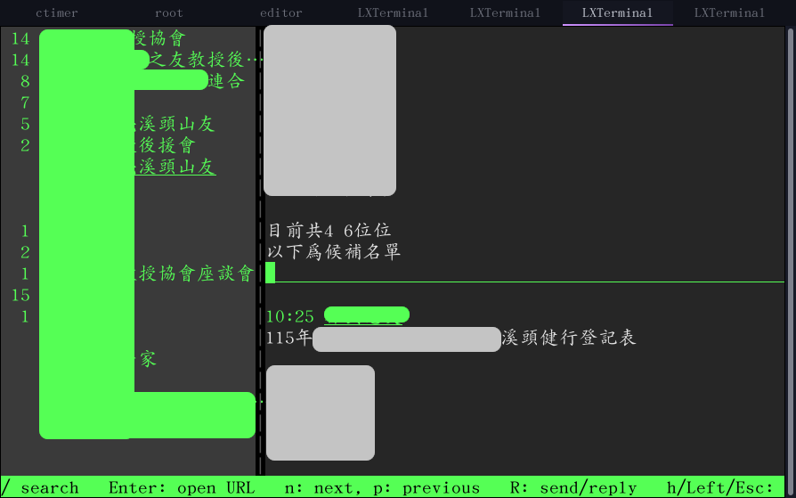

# OmniLine

OmniLine is a set of three frontends for LINE, a popular messaging app in Taiwan. OmniLine provides the user interfaces; authentication and communication are provided by [OkLine](https://nicedayzc.github.io/OkLine/), created by NiceDayZc.

The three frontends of OmniLine are:
- **omniline cli**: a bare-bones command-line frontend, mostly for testing
- **omniline tui**: a terminal user interface for reading and sending messages
- **omniline web**: to be written

## Installation and Initialization

Create and activate a Python virtual environment, using either `pip` or `uv`. Then:
```
uv pip install omniline
omniline init
```
or
```
pip install omniline
omniline init
```
`omniline init` creates `$HERMES_HOME/.omniline/` and copies the default configuration and themes. Existing files are preserved; use `omniline init --force` to replace them. The virtual environment may be located elsewhere.

## Logging In

1. Have your main LINE device at hand
2. Log in to your LINE account from the Python virtual environment: `okline login`
3. A QR code will be printed. On your main LINE device, navigate to "add contact" => "scan QR code", and scan the QR code.
4. The main device will ask for a 6-digit pin. Read it from the command line, enter it into the main device, and confirm login.
5. A tokens.json file will be generated, possibly overwriting existing one. This is your login credential. Keep it secret. All future omniline commands need to read it.


## Using the TUI

Start the TUI with `omniline tui`.

The full-screen layout has a chat list on the left and the selected chat or
profile on the right. The status bar shows the currently available keyboard
commands.

- List mode: navigate chats, search, open a chat, open a profile, refresh unread
  counts, and quit.
- Profile mode: view chat information, pin or unpin the chat, and return.
- Content mode: navigate and search messages, move between search matches, open
  the first URL on the current line, compose a new message or reply, and return.
- Search and compose overlays: enter text, submit it, or cancel with the shown
  keys. Sending follows the configured confirmation and cursor-line safeguards.

Important settings are in `$HERMES_HOME/.omniline/config.toml`: the token-file path, shared
pinned chats, history limit, TUI theme, and conservative sending options. Dark
and light themes are stored under `$HERMES_HOME/.omniline/themes/`.



## Using the Web Interface

The first web version displays `omniline web` after login. Messaging routes
will be added later. Flask, Gunicorn, and the required Apache proxy modules
are already declared or installed as follows:

- Python dependencies: `flask` and `gunicorn` (installed by `uv sync` or
  `pip install omniline`)
- Debian package: `apache2` (only needed for the Apache deployment)
- Apache modules: `proxy`, `proxy_http`, and `headers`

### Initialize web authentication

Create the password verifier and Flask session-signing secret interactively:

```
omniline web --init-auth
```

This creates:

```
$HERMES_HOME/.omniline/password.hash
$HERMES_HOME/.omniline/session.secret
```

The password is never stored in clear text. Both files are created with
restrictive permissions and must remain private. Authentication is enabled by
default and is not disabled by the HTTP/HTTPS configuration.

Login attempts are appended as JSON lines to `$HERMES_HOME/.omniline/access.log`; the
password itself is never logged. The `[web]` section of `config.toml` controls
the rolling failure limit:

```
[web]
max_failed_attempts = 5
failed_attempt_window_seconds = 300
session_lifetime_hours = 24
```

After five failed attempts, further attempts are rejected until the rolling
five-minute window expires. The current deployment assumes one Gunicorn
worker, so the access log itself is the shared rate-limit state. If multiple
workers are introduced later, replace this with a transactional shared store
such as SQLite or Redis.

Successful logins create permanent Flask sessions that expire after 24 hours.
The expiration is absolute rather than extended on every request, so a user
must authenticate again after the configured lifetime.

### Local HTTP development server

Run the Flask development server on loopback:

```
omniline web
```

Open `http://127.0.0.1:1730/`. This server is for development only. For plain
HTTP development, do not set `OMNILINE_COOKIE_SECURE`.

For a temporary password verifier, without replacing
`$HERMES_HOME/.omniline/password.hash`, use:

```
omniline web --password-file /path/to/temporary-password.hash
```

The file must contain an OmniLine scrypt verifier and have restrictive file
permissions. The session-signing secret is still read from
`$HERMES_HOME/.omniline/session.secret`.

### Gunicorn

Gunicorn cannot pass arbitrary options directly to the WSGI application, but it
can call OmniLine's application factory. This selects token and password files
without adding corresponding environment variables:

```
HERMES_HOME=/h/.hermes gunicorn --chdir /h/ext/OmniLine \
    --bind 127.0.0.1:8001 \
    'omniline.web:create_app(tokens_file="/h/.hermes/.omniline/tokens.json", password_file="/h/.hermes/.omniline/password.hash")'
```

The single quotes are shell quoting around Gunicorn's application-factory
expression; the inner double quotes delimit Python string arguments. This is
equivalent to selecting `--tokens-file` and `--password-file` for `omniline web`,
but uses the production WSGI server directly.

Run Gunicorn on a loopback address:

```
uv run gunicorn \
    --bind 127.0.0.1:8001 \
    omniline.web:app
```

For an HTTPS deployment behind Apache, set the cookie transport flag:

```
OMNILINE_COOKIE_SECURE=1 \
uv run gunicorn \
    --bind 127.0.0.1:8001 \
    omniline.web:app
```

`OMNILINE_COOKIE_SECURE` controls only the browser's `Secure` cookie
attribute. It does not bypass password checking. Password checking always
occurs; there is no authentication-bypass environment variable.

### Optional Fail2ban IP bans

The application limiter is global. Fail2ban can add a second, IP-specific
layer with longer bans. Create `/etc/fail2ban/filter.d/omniline.conf`:

```ini
[Definition]
# Fail2ban removes the matched date before applying failregex.
datepattern = "time":"{DATE}",
failregex = ^.*"result":"(?:failure|blocked)".*"remote_addr":"<HOST>".*$
ignoreregex =
```

The `datepattern` is important for this JSON-lines format. Some Fail2ban
versions do not automatically recognize the embedded ISO-8601 timestamp; when
that happens, `fail2ban-regex` reports no matches or no usable timestamps.
The `failregex` therefore matches the log record after the timestamp has been
removed.

For example, create `/etc/fail2ban/jail.d/omniline.local`:

```ini
[omniline]
enabled = true
filter = omniline
logpath = /home/YOUR_USER/.omniline/access.log
maxretry = 5
findtime = 300
bantime = 3600
```

Replace `YOUR_USER`, then test and reload:

```bash
sudo fail2ban-regex \
    /home/YOUR_USER/.omniline/access.log \
    /etc/fail2ban/filter.d/omniline.conf
sudo fail2ban-client reload
sudo fail2ban-client status omniline
```

Apache must preserve the client address, and the Apache-to-Gunicorn path must
include:

```apache
ProxyAddHeaders On
```

The application trusts one forwarded proxy hop. Gunicorn must remain bound to
`127.0.0.1`; otherwise clients could forge `X-Forwarded-For`.

### Common security precautions

- Use HTTPS in deployment and set `OMNILINE_COOKIE_SECURE=1` for Gunicorn.
- Keep Gunicorn on loopback and use Apache as the public TLS boundary.
- Never enable Flask debug mode in deployment.
- Keep `password.hash`, `session.secret`, and `access.log` private with mode
  `0600`; rotate the access log and retain it only as long as needed.
- Use a real password. A single-space password is suitable only for temporary
  testing.
- Add CSRF protection before implementing any state-changing operation such as
  sending, deleting, pinning, or changing settings.
- Keep forwarded-header trust limited to the known Apache proxy hop.
- Return generic backend errors and never expose tokens, message payloads, or
  encrypted material in HTML responses or logs.

### Apache2 path-specific reverse proxy

If Apache already serves other pages, add the following inside the existing
HTTPS `<VirtualHost>` block. It makes only `/omniline/` reach Gunicorn:

```
RedirectMatch 301 ^/omniline$ /omniline/

ProxyAddHeaders On
ProxyPass        /omniline/ http://127.0.0.1:8001/
ProxyPassReverse /omniline/ http://127.0.0.1:8001/

<Location /omniline/>
    RequestHeader set X-Forwarded-Prefix "/omniline"
    Require all granted
</Location>

ProxyPassReverseCookiePath / /omniline/
```

Place these rules before a generic `ProxyPass / ...` rule, if one exists.
`X-Forwarded-Prefix` allows Flask to generate redirects such as
`/omniline/login` rather than `/login`. `ProxyPassReverseCookiePath` keeps the
authentication cookie scoped to OmniLine.

Enable the modules and validate the configuration:

```
sudo a2enmod proxy proxy_http headers
sudo apache2ctl configtest
sudo apache2ctl -k graceful
```

On systems without `systemctl`, use `apache2ctl -k start`, `-k graceful`, and
`-k stop`. Start Gunicorn before testing the Apache proxy. The public URL is:

```
https://your-host/omniline/
```

Gunicorn should remain bound to `127.0.0.1`; Apache is the public TLS and
reverse-proxy boundary.

## License

[MIT](LICENSE)
